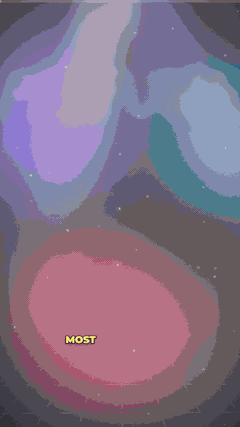

# Content Studio 🎬

**Edit short-form videos with AI.** Drop in a raw clip, tell Claude Code "edit this", and get back a finished vertical short (Reels / TikTok / Shorts). It comes with:

- word-synced captions
- motion graphics that appear exactly when you say things
- camera punch-ins, film grain and light leaks
- sound effects

Everything runs **locally on your Mac**. There are no subscriptions, no uploads and no watermarks.

<p align="center"></p>

## How it works

```
raw clip ──► cut silences ──► transcribe (word timings) ──► remove background
                                         │
                       Claude reads the transcript and designs
                       the edit as cues.json (hook, cards, stats,
                       stickers, zooms, CTA…), snapped to your words
                                         │
                       Remotion renders ──► output/<name>.mp4
```

| Step | Tool (free, local) |
|---|---|
| Silence cutting | [auto-editor](https://github.com/WyattBlue/auto-editor) |
| Transcription | [mlx-whisper](https://github.com/ml-explore/mlx-examples) (Apple Silicon) |
| Background removal | [RobustVideoMatting](https://github.com/PeterL1n/RobustVideoMatting) |
| Rendering | [Remotion](https://remotion.dev) + ffmpeg |
| The editor | [Claude Code](https://claude.com/claude-code) |

## Quick start

Requires an Apple Silicon Mac, [Homebrew](https://brew.sh) and [Claude Code](https://claude.com/claude-code).

```bash
git clone <this repo> content-studio && cd content-studio
./setup.sh                 # installs ffmpeg, auto-editor, Python + Node deps, model, sound effects
```

Put a clip in `inbox/`, open Claude Code in this folder and say:

> edit inbox/my-clip.mp4, it's a food vlog, make it punchy

Claude prepares the footage, writes the graphics, checks preview frames and renders `output/my-clip.mp4`. Ask for changes in plain words ("bigger hook", "add a price sticker at 0:05", "less zoom") and it re-renders.

### Manual workflow
```bash
scripts/prepare.sh inbox/my-clip.mp4 my-clip          # English, fast
scripts/prepare.sh inbox/my-clip.mp4 my-clip medium   # better for Bangla / accents
# edit public/videos/my-clip/cues.json  (see examples/)
npm run studio                                        # live preview in the browser
scripts/render.sh my-clip                             # -> output/my-clip.mp4
```

Three modes:
- **Talking head** (default): you, cut out of your background, over an animated studio, graphics or b-roll.
- **Footage** (`"footage": true`): full-screen vlog/b-roll with graphics on top.
- **Voice-over** (`"voice": true`): give `prepare.sh` an audio file (mp3/m4a/wav…) instead of a video. Your voice narrates; the picture is built from full-screen stock `scene`s, cards and captions timed to your words.

### Voice-over videos
```bash
scripts/prepare.sh inbox/ai-future.m4a ai-future                 # cut silences, level, transcribe
export PEXELS_API_KEY=...                                        # free key: https://www.pexels.com/api/
.venv/bin/python scripts/stock.py ai-future "robot arm factory"  # portrait clips -> public/videos/ai-future/stock/
.venv/bin/python scripts/stock.py ai-future "city night" --photos
```
Or just say *"make a video from inbox/ai-future.m4a"* and Claude picks the searches. Without a Pexels key, drop your own images/clips in `public/assets/` or go text-only on the animated studio.

## cues.json

```json
{
  "accent": "#7C5CFF",
  "accent2": "#FFE14D",          // emphasis / gradient color
  "background": null,            // or "assets/backgrounds/city.mp4" / ".jpg" (default: animated studio)
  "music": "assets/music/lofi.mp3",
  "musicVolume": 0.08,
  "emphasis": ["doesn't", "free"], // caption words that get the accent slab (numbers are automatic)
  "captionStyle": "pop",         // "pop" = words appear as spoken, "box" = full line + highlight
  "sfx": true, "sfxVolume": 0.35, // auto whoosh/pop/ding/impact per cue
  "punch": true,                 // snap-zoom the camera on every cue
  "film": true,                  // grain, vignette, light-leak flash on cuts
  "progress": true,              // progress bar on top
  "cues": [
    {"from": 0, "to": 2.4, "type": "hook", "text": "Perfume lasts all day?", "highlight": ["all", "day"]},
    {"from": 2.4, "to": 4.8, "type": "title", "text": "It doesn't.", "sub": "3 tricks"},
    {"from": 2.5, "to": 4.6, "type": "sticker", "text": "Myth", "emoji": "❌", "x": 74, "y": 36, "rotate": 8},
    {"from": 4.8, "to": 11, "type": "steps", "items": ["A", "B", "C"], "at": [4.84, 6.8, 8.94]},
    {"from": 11, "to": 13.5, "type": "stat", "value": 70, "suffix": "%", "label": "fades in 4h"},
    {"from": 11, "to": 13, "type": "burst", "emoji": ["🌸", "💨"], "count": 18, "mode": "explode"},
    {"from": 14, "to": 17, "type": "bullets", "title": "Why", "items": ["x", "y"]},
    {"from": 17, "to": 20, "type": "compare", "left": {"title": "Cheap", "items": ["..."]}, "right": {"title": "Premium", "items": ["..."]}},
    {"from": 20, "to": 23, "type": "image", "src": "assets/images/bottle.jpg", "caption": "..."},
    {"from": 23, "to": 26, "type": "pointer", "x": 22, "y": 58, "shape": "circle", "label": "This one 👀"},
    {"from": 23, "to": 26, "type": "zoom", "scale": 1.3, "x": 22, "y": 58},
    {"from": 0, "to": 4, "type": "scene", "src": "videos/ai-future/stock/robot-arm-factory-1.mp4", "move": "in"},
    {"from": 26, "to": 29, "type": "rating", "title": "Verdict", "items": [{"label": "Taste", "value": 4.5}]},
    {"from": 29, "to": 32, "type": "bars", "title": "Price", "items": [{"label": "Here", "value": 48}, {"label": "Mall", "value": 95}], "suffix": "¥"},
    {"from": 0, "to": 2.5, "type": "location", "place": "Chengdu", "sub": "Hidden gem", "pos": "bottom"},
    {"from": 32, "to": 35, "type": "cta", "text": "Would you try it? 👇", "handle": "@you"}
  ]
}
```
Times are seconds in the *prepared* (silence-cut) video. `at` makes list items appear exactly when spoken.
Cues may overlap (e.g. a `sticker`/`pointer`/`burst`/`zoom` on top of a card).
Every cue also accepts `pos` (`top`/`center`/`bottom`, card cues), `sfx: false`, `shake: true`.

| type | what it does |
|---|---|
| `hook` | giant slammed-in words with camera shake + impact; use for the first 1–3 s |
| `title` / `bullets` / `steps` / `compare` / `stat` / `icon` / `image` | animated glass cards (3D drop, rim glow, shine, count-ups, % ring) |
| `sticker` | tilted badge slapped anywhere (`x`,`y` in %) |
| `pointer` | hand-drawn `circle` / `arrow` at `x`,`y` (%) with a label — point at things in the shot |
| `zoom` | invisible camera push into `x`,`y` (%) for the cue's duration |
| `scene` | full-screen stock image/clip (`src`) under the cards with a slow Ken Burns `move` (`in`/`out`/`left`/`right`/`up`/`down`), `dim` (0–1, default 0.35), `start` (s into the clip); crossfades from the previous scene |
| `burst` | full-screen emoji particles (`explode` or `rain`) |
| `rating` / `bars` | star ratings / animated bar chart |
| `location` | pin drop + typed place name |
| `cta` | follow button with animated cursor click + hearts |

Sound effects live in `public/assets/sfx/` (regenerate with `scripts/make-sfx.sh`).

## Project layout
- `.claude/skills/edit-video/` is the AI editing playbook Claude follows
- `scripts/` is the prep pipeline (silence cut, reframe, transcribe, cutout, stock, sfx)
- `src/` is the Remotion template: `Explainer.tsx` (layers), `graphics/` (cues, captions, camera, film, particles, sfx)
- `examples/` has sample `cues.json` files
- `public/assets/` holds your music, backgrounds, images and logos (free sources: Pexels, Pixabay)

## License
MIT for this project's code. **Remotion has its own license:** it's free for individuals and companies of up to 3 people, and larger companies need a [company license](https://remotion.dev/license).
